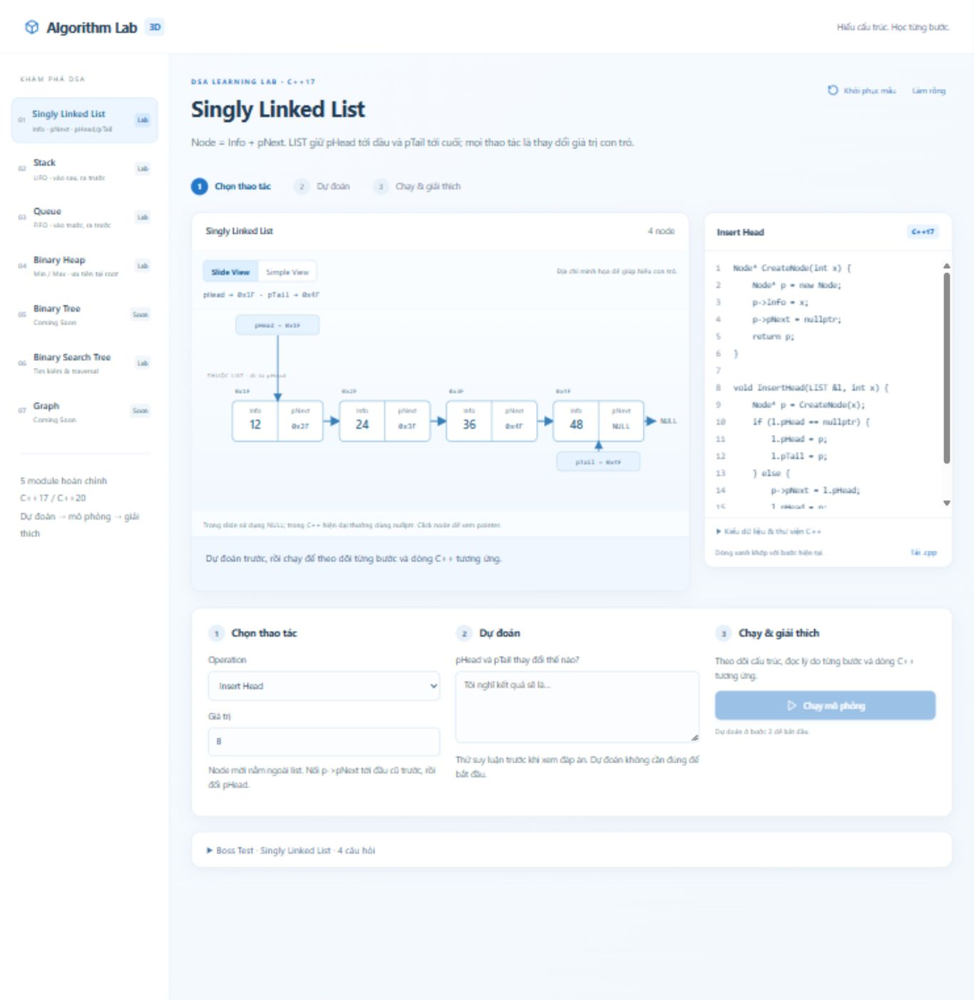
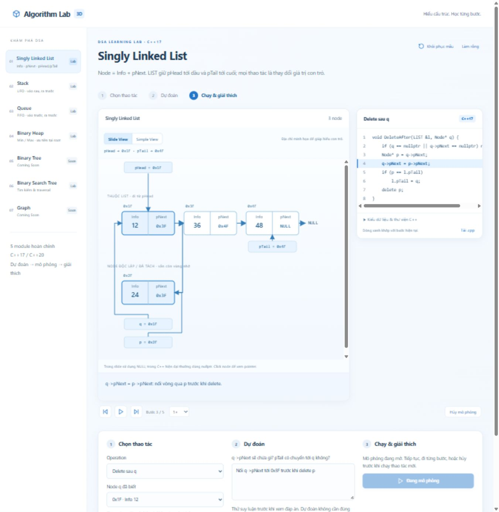
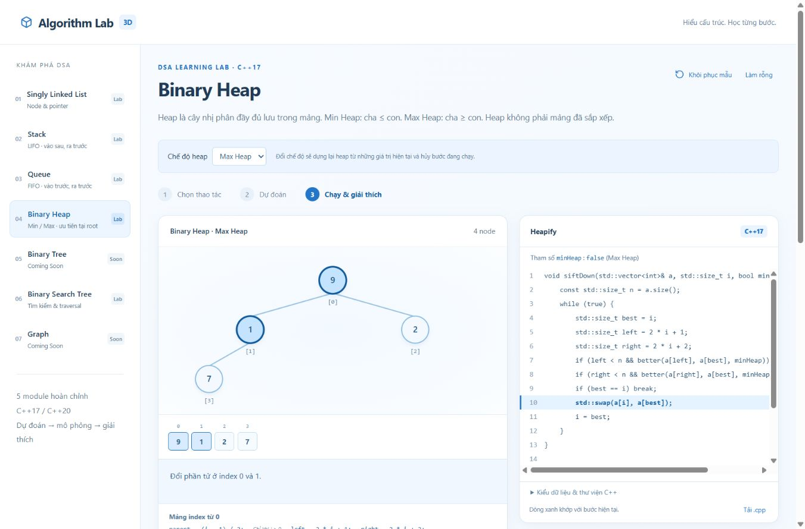
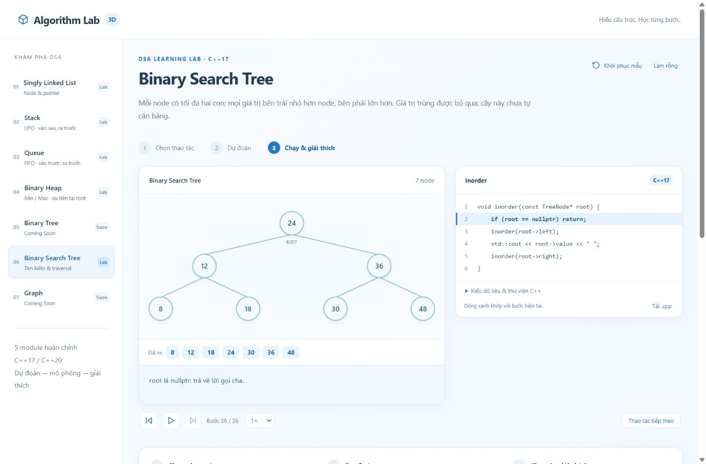

# Algorithm Lab 3D

A Vietnamese DSA learning application built with React 19 and Vite. The learning flow is **choose an operation → predict → simulate and explain**. Light blue and white cards keep the structure, pointers and C++ source readable. All student-facing algorithm source is C++17-compatible and also compiles as C++20; JavaScript is used only internally.

## Implemented labs

| Module | Operations | Behavior |
|---|---|---|
| Singly Linked List | CreateList, CreateNode, Insert Head/Tail, Delete Head, Delete after known q, Delete by Info, Search, Traverse | Slide naming: Info/pNext and LIST.pHead/pTail. Search returns a node pointer or nullptr. Duplicates allowed. |
| Stack | Push, Pop, Peek/Top, Traverse | Linked implementation; vertical top-to-bottom view. Capacity is optional and disabled by default. |
| Queue | Enqueue, Dequeue, Front, Rear, Traverse | Linked implementation with explicit front/rear pointers, including the last-node transition. |
| Binary Heap | Insert, Extract Root, Heapify, Peek | Min and Max modes, animated swaps, binary tree and indexed array views. Mode changes rebuild the current values. |
| Binary Search Tree | Insert, Search, Inorder, Preorder, Postorder | Unique keys; duplicate inserts are ignored. Unbalanced BST with automatic positioning. |

Binary Tree and Graph have navigation pages marked Coming Soon.

### Linked List slide model

Default Slide View shows each allocation as two explicit cells, Info and pNext, with a stable simulated hexadecimal address. Arrows originate from pNext and follow the actual stored links. pHead/pTail and algorithm variables p/q are separate animated pointer objects. The diagram distinguishes reachable nodes from independent or detached allocations; a freed address is marked as deleted rather than treated as a live node. Simple View provides the value chain. Click or keyboard-activate a node to inspect its address, Info, pNext and target.

CreateNode assigns uninitialized fields step by step and leaves the returned node outside LIST. Each insertion allocates its own node; standalone lesson nodes remain independently owned until reinitialization/reset. CreateList itself is the two O(1) nullptr assignments. Reinitializing a populated lab first runs a visible cleanup routine, including independent nodes, to avoid leaking allocations; this cleanup is O(n).

Tests verify pHead, pTail and pTail->pNext after every completed edit, empty/one/two-node lists, repeated inserts, middle/tail deletion, first/middle/last/missing Search, and Traverse. Transient frames intentionally follow the exact C++ assignment order, including the short interval before pTail is updated during last-node deletion.

Every operation provides a mental model, prediction prompt, independent frame snapshots, source-line highlighting, explanations, replay and reset. Complexity appears after execution. Every completed module has four generated, automatically graded Boss Test questions with shuffled answers and explanations; a new round changes the data.






## Setup

Use Node.js 20.19+ or Node.js 22.12+ and npm. From this directory:

```sh
npm install
npm run dev
npm test
npm run build
npm run preview
```

The local production preview serves `dist` at http://127.0.0.1:5175/ (override with `PORT`). The server binds only to localhost. Deploy `dist` to a static hosting service with the app at the site root.

The Codex Windows environment used for this work rejects Vite's child-process launch with `spawn EPERM`. This is an environment restriction. The normal Vite build remains available for ordinary environments. A tested Windows x64 alternative invokes the installed esbuild executable directly, minifies React in production mode, creates the HTML/CSS bundle and copies public assets:

```powershell
npm run build:windows
npm run preview
```

## Architecture

```text
src/
  core/
    contracts.js       C++ line markers, trace builder, input validation
    session.js         Pure playback/transaction reducer
    useSimulation.js   Shared React controller and cancellable timer
    quiz.js            Seeded data generation and answer shuffling
    layout.js          Pure tree coordinate calculations
  modules/
    linked.js          Independent state, C++, operation definitions, traces
    stack.js
    queue.js
    heap.js
    bst.js
    *.quiz.js          Each module's question factory
    index.js           Module registry and roadmap
  components/
    Visualizer.jsx     Shared linear/stack/tree renderers
    CodePanel.jsx      Source display, exact highlight, .cpp download
    LinkedVisualizer.jsx Slide diagram, separate pointers and node inspector
    BossTest.jsx       Shared quiz rendering and grading
  main.jsx             Navigation and shared learning flow
  tests.js             Algorithm, reducer, content and layout regression tests
scripts/
  build-windows.ps1    Direct production bundling alternative
  export-cpp.mjs       Exports student snippets and executable C++ assertions
```

### Module contract

A module exports `id`, `name`, `kind`, `mental`, `support` (C++ types/includes), `operations`, `createState(empty, config)`, `generate(state, operation, input, config)`, `quiz(context)` and `values(state)`. Optional `settings`, `defaultConfig`, `settingsNote` and `configure(state, config)` support capacity and heap modes. Register new modules in `modules/index.js`. A new visual structure may also need a renderer; playback, prediction, source display and grading remain shared.

Each operation declares its input type (`integer`, `array`, `node` (a known node ID) or `none`), mental model, prediction and marked C++ source. Internal markers such as `// @swap` resolve to source indices and are stripped before display/download. The trace builder rejects missing markers and clones each frame. Frames contain state, line, reason, highlighted node IDs and optional output, swap, pending-node or removed-node metadata. Generation never mutates the caller's state.

### State and playback guarantees

The reducer separates **committed state** from **displayed trace snapshots**. Only reaching the final frame commits the new structure, once. Replay moves through the original snapshots and cannot insert/delete again. Cancel, operation/input/config changes and reset invalidate the playback generation; timer ticks from an old generation are ignored. Pause/resume and manual stepping also invalidate old timers.

Switching modules keeps each module's committed structure and configuration in an in-memory cache, while cancelling its open simulation. Reset restores a sample or an empty structure, retains settings and clears predictions, explanations and quiz answers. A stack sample respects enabled capacity. Refreshing the page clears the session; there is no backend or persistent account state.

### Correctness and complexity

Stable node IDs preserve identity across edits and heap swaps. Queue pointer assignment and stack size changes are represented on their exact C++ lines, including transient states before `delete`. Empty reads/removals in Stack, Queue and Heap use `std::nullopt`; BST searches use `nullptr`.

Complexity labels describe the C++ algorithm, excluding UI snapshots and rendering. Stack/Queue mutations and reads are O(1); traversals O(n). Linked Insert Head/Tail, Delete Head and Delete after known q are O(1). Delete by Info, Search and Traverse are O(n). Heap extraction is O(log n), bottom-up Heapify O(n), Peek O(1); vector insertion is amortized O(log n), with a possible O(n) allocation/move. BST insert/search are O(h), worst-case O(n); traversal is O(n) with O(h) recursive call stack. The BST is deliberately not self-balancing.

Input uses strict decimal signed C++ `int` bounds. Fractional numbers, exponent syntax, invalid tokens and empty comma entries are rejected. Heapify accepts an empty array and at most 128 values per lesson. Capacity, when enabled, must be an integer from 1 to 10,000 and cannot be reduced below the current stack size.

## Verification

`npm test` passes **21 regression groups** covering all 27 operations, empty/singleton/duplicate/missing/extreme values, repeated cycles, random heap reference models, BST traversal orders, snapshot isolation, exact line mapping, pointer/size assignment timing, stale timers, reset/replay, generated quizzes and non-overlapping tree layouts. It also audits all module source/support content for JavaScript teaching syntax.

The displayed C++ was additionally exported and compiled with MSVC under both C++17 and C++20: **64 syntax checks (32 translation units × 2 standards), `/W4 /WX`, zero warnings**. Five executable C++ harnesses passed assertions for empty behavior, duplicates, ordering, capacity, pointer cleanup and heap modes. To export the same sources:

```sh
node scripts/export-cpp.mjs
```

Compile `cpp-check/*.cpp` with your C++17/20 compiler; `*-all.cpp` files include assertion-based `main` functions. Individual operation files are translation units without a `main` and should be syntax-checked or compiled to objects.

Browser verification covers the operation flows, invalid input, reset during simulation, navigation, generated quiz grading/regeneration, replay and laptop/mobile layouts. The production artifact is minified with esbuild; the Vite command's environment limitation is recorded above.

## Roadmap and boundaries

- General Binary Tree and Graph modules using the same contracts.
- AVL/Red-Black trees and a separate BST deletion lesson.
- Automated browser regression scripts in CI and compiler checks on Linux/Windows.
- Optional saved learning sessions, localization and keyboard playback shortcuts.
- Worker-backed trace generation for very large lessons.

This is a client-only educational simulator. Prediction/reflection are self-assessed; Boss Tests are graded. “3D” remains the project name. The linked-list slide diagram uses SVG, Queue retains CSS perspective, and tree/stack renderers use SVG/HTML rather than WebGL. Large structures scroll inside the visualizer. Reduced-motion preferences disable transitions.
